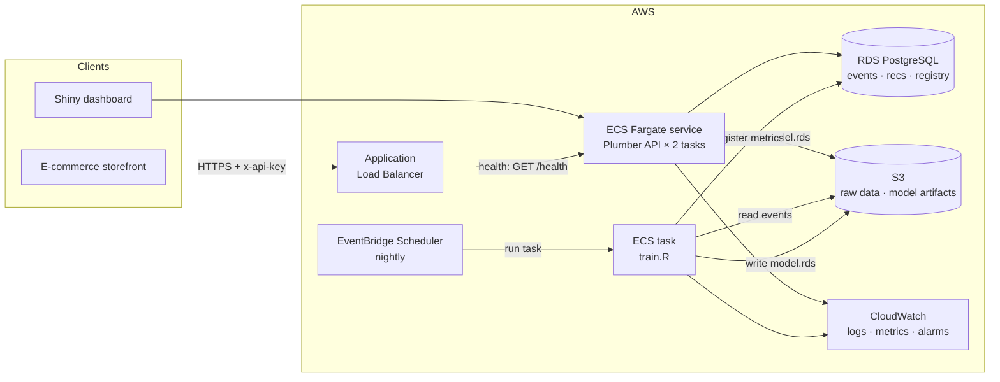

# r-aws-product-recommendation-engine

[](https://github.com/OWNER/r-aws-product-recommendation-engine/actions/workflows/deploy.yml)
[](https://cran.r-project.org/)
[](Dockerfile)
[](LICENSE)

A production-grade product recommendation platform: **hybrid machine learning in R** (collaborative filtering + content-based + popularity), served through a **Plumber REST API**, containerized with **Docker**, and deployed on **AWS** (ECS Fargate, RDS PostgreSQL, S3, CloudWatch) with CI/CD, evaluation tooling, an analytics dashboard, and scheduled retraining.

Built on the [Retailrocket e-commerce dataset](https://www.kaggle.com/datasets/retailrocket/ecommerce-dataset) — ~2.7M real behavioural events (views, add-to-cart, transactions).

---

## Table of contents

- [Architecture](#architecture)
- [The recommendation engine](#the-recommendation-engine)
- [Repository layout](#repository-layout)
- [Prerequisites](#prerequisites)
- [Quickstart (5 minutes, synthetic data)](#quickstart-5-minutes-synthetic-data)
- [Using the real dataset](#using-the-real-dataset)
- [Training pipeline](#training-pipeline)
- [API reference](#api-reference)
- [Configuration](#configuration)
- [Evaluation methodology](#evaluation-methodology)
- [Database](#database)
- [Dashboard](#dashboard)
- [AWS deployment](#aws-deployment)
- [CI/CD](#cicd)
- [Security model](#security-model)
- [Operations](#operations)
- [Cost estimate](#cost-estimate)
- [Testing](#testing)
- [Troubleshooting](#troubleshooting)
- [Design decisions](#design-decisions)
- [Roadmap](#roadmap)

---

## Architecture



**Request path (online):** storefront → ALB → Plumber API → score against in-memory model → ranked items. Latency is dominated by a single matrix-vector product; no database call is required to serve a recommendation.

**Training path (offline):** raw events in S3 → `train.R` (ingest → clean → split → factorize → blend → evaluate) → `model.rds` to S3 → metrics row in `model_registry` → rolling ECS redeploy picks up the new artifact.

The API also accepts `POST /feedback` events, which are written to RDS and picked up by the next training run — closing the learning loop.

---

## The recommendation engine

Three components combined into a hybrid scorer:

| Component | Signal | Implementation | Handles |
|---|---|---|---|
| Collaborative filtering | "Users like you also bought…" | Matrix factorization via `recosystem` (LIBMF), 32 latent factors | Behavioural patterns |
| Content-based | "Items similar to what you liked" | IDF-weighted item-property vectors, cosine similarity | New/sparse items |
| Popularity | "Trending now" | Time-decayed weighted event counts (τ = 30 days) | Cold start, fallback |

**Scoring:**

```
Score(u, i) = [ w_cf · CF(u, i) + w_cb · CB(u, i) + w_pop · POP(i) ] / (active weights)

default: w_cf = 0.5, w_cb = 0.3, w_pop = 0.2
```

Each component is rescaled to [0, 1] before blending. The denominator renormalizes by whichever components are actually available, so the model degrades gracefully instead of breaking:

**Cold-start ladder**

| Situation | CF | CB | POP | Notes |
|---|:-:|:-:|:-:|---|
| Known user with history | ✅ | ✅ | ✅ | Full hybrid |
| Known user, no item features | ✅ | — | ✅ | Weights renormalize to 0.5/0.2 |
| Unknown user + `recent` items passed | — | ✅ | ✅ | Session-based personalization |
| Unknown user, nothing | — | — | ✅ | Pure popularity — a sensible default |

**Implicit feedback weights** (configurable in `R/config.R`): `view = 1`, `addtocart = 3`, `transaction = 5`, summed per (user, item) then log-dampened via `log1p` so power users don't dominate.

Already-owned items are **always excluded** from recommendations.

---

## Repository layout

```
├── R/                              # Core library code
│   ├── utils.R                     #   %||%, rescale01 helpers
│   ├── config.R                    #   Central config (env-var driven)
│   ├── data_ingestion.R            #   Retailrocket loaders (data.table)
│   ├── data_cleaning.R             #   Dedup, bot filtering
│   ├── feature_engineering.R       #   Interactions, temporal split, matrices, popularity
│   ├── collaborative_filtering.R   #   recosystem training → P/Q factors
│   ├── content_based.R             #   Item-item cosine similarity
│   ├── hybrid_model.R              #   recommend_items() — the serving scorer
│   ├── model_evaluation.R          #   Precision/Recall/MAP/NDCG @ K
│   ├── db.R                        #   PostgreSQL access (gracefully optional)
│   └── recommendation_service.R    #   Model loading, S3 sync
│
├── api/
│   ├── plumber.R                   # Thin annotated router (routes + auth filter)
│   └── endpoints.R                 # Plain handler functions — unit-testable
│
├── dashboard/
│   ├── ui.R                        # UI definition
│   ├── server.R                    # Server logic
│   └── app.R                       # Bootstrapper: loads model/DB, launches app
│
├── database/
│   ├── schema.sql                  # PostgreSQL schema
│   └── seed_data.sql               # Demo customers/products/events (idempotent)
│
├── aws/
│   ├── iam/                        # Least-privilege policies
│   │   ├── task-role-api.json      #   Serving task: S3 read on models/ only
│   │   ├── task-role-training.json #   Training task: read raw/, write models/
│   │   └── execution-role-secrets.json
│   ├── infrastructure/             # Manual console steps + Terraform plan
│   └── deployment/
│       ├── deploy.sh               #   One-time provisioning
│       └── task-definition.json    #   ECS Fargate task definition
│
├── data/
│   ├── raw/                        # Retailrocket CSVs (gitignored)
│   ├── processed/                  # Intermediate artifacts (gitignored)
│   └── sample/
│       └── generate_sample_data.R  # Synthetic data generator (CI-friendly)
│
├── tests/
│   ├── testthat/
│   │   ├── helper_tiny_model.R     #   Shared fixture (2 users × 4 items)
│   │   ├── test_metrics.R          #   Known-answer metric tests
│   │   └── test_hybrid.R           #   Cold start, exclusion, similarity
│   └── test_api.R                  # Handler-level API tests (no server needed)
│
├── models/
│   └── README.md                   # Artifact contract + lifecycle + rollback
│
├── train.R                         # Offline training pipeline (entry point)
├── run_api.R                       # API entry point (also the container CMD)
├── run_tests.R                     # Test runner used by CI
├── Dockerfile                      # rocker/r-ver + renv
├── .dockerignore
├── .Rprofile                       # renv activation
├── renv.lock
├── .github/workflows/deploy.yml    # test → build → push → deploy
├── .gitignore
└── README.md
```

**Layering rule:** `api/plumber.R` contains only routing and annotations; all logic lives in `api/endpoints.R` as plain functions, which is what makes the API testable without starting a server.

---

## Prerequisites

| Tool | Version | Why |
|---|---|---|
| R | ≥ 4.4 | Core runtime |
| Rtools | 4.4 (Windows only) | Compiles `recosystem` from source |
| Docker Desktop | latest | Local DB + container builds |
| AWS CLI | v2 | Deployment |
| Kaggle CLI | any | Downloading the real dataset |

```r
install.packages(c("data.table", "dplyr", "recosystem", "recommenderlab",
                   "text2vec", "Matrix", "plumber", "DBI", "RPostgres",
                   "paws", "testthat", "shiny", "ggplot2", "jsonlite"))
renv::init()   # then renv::snapshot() once stable
```

---

## Quickstart (5 minutes, synthetic data)

No Kaggle account needed — the generator produces schema-identical sample data with real collaborative structure (500 users, 800 items, 40k events, taste-driven preferences):

```bash
# 1. Generate sample data
Rscript data/sample/generate_sample_data.R

# 2. Train + evaluate (prints hybrid vs popularity-baseline metrics)
DATA_RAW=data/sample Rscript train.R

# 3. Run unit + API tests
Rscript run_tests.R

# 4. Serve
Rscript run_api.R
```

```bash
curl http://localhost:8000/health
# {"status":"ok","model_id":"hybrid-20250115-093012","uptime_seconds":4.1}

curl -H "x-api-key: dev-key-change-me" \
  "http://localhost:8000/recommendations/42?n=5"

curl -H "x-api-key: dev-key-change-me" "http://localhost:8000/similar/187?n=5"
```

Interactive docs (Swagger UI): **http://localhost:8000/__docs__/**

---

## Using the real dataset

```bash
pip install kaggle   # configure ~/.kaggle/kaggle.json first
kaggle datasets download -d retailrocket/ecommerce-dataset -p data/raw --unzip
Rscript train.R      # now reads data/raw/ by default
```

Expect training to take several minutes on ~2.7M events; the CF step uses all available cores.

> **Never commit data or models.** `data/raw/`, `data/processed/`, and `models/` are gitignored (with a `!models/README.md` exception so the artifact contract stays in the repo). Raw data lives in S3; model artifacts live in S3 with versioning.

---

## Training pipeline

`train.R` runs the full offline workflow and is what the scheduled ECS task executes:

1. **Ingest** — `fread` events + item properties; convert epoch-ms timestamps
2. **Clean** — deduplicate, drop the top 0.1% most active visitors (bots)
3. **Split** — temporal: last 15% of time is held out (never random — see [Design decisions](#design-decisions))
4. **Weight** — implicit feedback matrix with event weights + log damping
5. **Train CF** — `recosystem` factorization → persists **P and Q matrices** (see note below)
6. **Features** — IDF-weighted, L2-normalized item-property vectors
7. **Popularity** — exponential time decay, τ = 30 days
8. **Evaluate** — Precision/Recall/MAP/NDCG @10 on held-out transactions **vs a popularity-only baseline**
9. **Persist** — `models/model.rds` locally, upload to `MODEL_S3_URI` if set, register metrics in `model_registry`

Model artifacts are self-describing — the full field-by-field contract is documented in [`models/README.md`](models/README.md):

```r
model <- readRDS("models/model.rds")
model$model_id          # "hybrid-20250115-093012"
model$metrics$mean      # precision/recall/MAP/NDCG @10
model$metrics$baseline_popularity
```

> ⚠️ **Why we persist P/Q instead of the recosystem object:** `Reco` holds a C++ pointer that does not survive `saveRDS()`. The factor matrices are all serving needs — a recommendation is just `P[u, ] %*% t(Q)` — so we store those and drop the pointer.

---

## API reference

All endpoints except `/health` and docs require the header `x-api-key`.

| Method | Path | Params | Description |
|---|---|---|---|
| GET | `/health` | — | Liveness + model id + uptime (public, used by ALB) |
| GET | `/recommendations/<user_id>` | `n=10`, `recent=id1,id2` | Personalized hybrid ranking |
| GET | `/similar/<item_id>` | `n=10` | Content-based similar items |
| GET | `/popular` | `n=10` | Trending items |
| POST | `/feedback` | JSON body | Record an event for the next retrain |

**Example — personalized request:**

```bash
curl -H "x-api-key: $API_KEY" \
  "https://api.example.com/recommendations/1150086?n=5&recent=187946,21322"
```

```json
{
  "user_id": "1150086",
  "model_id": "hybrid-20250115-093012",
  "cold_start": false,
  "recommendations": [
    { "itemid": "461686", "score": 0.812, "cf": 0.91, "cb": 0.64, "popularity": 0.42, "rank": 1 }
  ]
}
```

**Feedback:**

```bash
curl -X POST -H "x-api-key: $API_KEY" -H "Content-Type: application/json" \
  -d '{"user_id":"1150086","item_id":"461686","event":"add_to_cart"}' \
  https://api.example.com/feedback
```

The response exposes per-component scores (`cf`, `cb`, `popularity`) so callers can build explanations ("because you bought X") and debug ranking behaviour. `n` is clamped to [1, 100] server-side; malformed `n` falls back to the default.

---

## Configuration

Everything environment-driven — the same image runs locally and on ECS unchanged:

| Env var | Default | Purpose |
|---|---|---|
| `DATA_RAW` | `data/raw` | Where training reads CSVs |
| `MODEL_DIR` | `models` | Local artifact path |
| `MODEL_S3_URI` | _(empty)_ | `s3://bucket/models/model.rds` — enables S3 sync |
| `DB_HOST` | _(empty)_ | If unset, DB features degrade gracefully |
| `DB_PORT` | `5432` | |
| `DB_NAME` / `DB_USER` | `reco` | |
| `DB_PASSWORD` | — | Inject from Secrets Manager in prod |
| `API_KEY` | `dev-key-change-me` | **Change before deploying** |
| `PORT` | `8000` | API port |

Model hyperparameters live in `R/config.R`: blend weights, CF dimensions/iterations/L2, event weights, popularity τ, test fraction. Edit, retrain, compare metrics — that's the tuning loop. To tune blend weights systematically, wrap `evaluate_model()` in a grid search over `config$weights`.

---

## Evaluation methodology

Held-out set = the **last 15% of time**, ground truth = test-window `transaction`/`addtocart` items per user.

| Metric | Meaning |
|---|---|
| Precision@10 | Fraction of the top-10 that were actually purchased |
| Recall@10 | Fraction of purchased items found in the top-10 |
| MAP@10 | Precision averaged at each hit position — rewards ranking hits early |
| NDCG@10 | Discounted cumulative gain — position-aware, graded |

`train.R` always prints the hybrid's metrics **next to a popularity-only baseline**. Rule of thumb:

> If the hybrid doesn't clearly beat popularity on NDCG@10, tune `cf$dim` (try 64) and `cf$niter` (try 40) **before** touching the blend weights. A weak CF component can't be fixed by re-weighting.

---

## Database

PostgreSQL (RDS in prod, Docker locally). Six tables: `customers`, `products`, `interactions`, `recommendations`, `model_registry` (metrics as JSONB — query with `metrics->>'ndcg_at_k'`), plus indexes on the interaction hot paths.

```bash
# Local development database — no RDS cost
docker run -d --name reco-db -p 5432:5432 \
  -e POSTGRES_USER=reco -e POSTGRES_PASSWORD=localpw -e POSTGRES_DB=reco postgres:16
docker exec -i reco-db psql -U reco -d reco < database/schema.sql

# Optional: demo customers, products, events and a seed registry row
docker exec -i reco-db psql -U reco -d reco < database/seed_data.sql

export DB_HOST=localhost DB_PASSWORD=localpw
```

The DB is **intentionally optional**: `db_connect()` returns `NULL` when `DB_HOST` is unset and every feature degrades gracefully (`POST /feedback` returns 503, the dashboard's registry tab stays empty). This keeps the API image runnable with nothing but a model file.

---

## Dashboard

```r
shiny::runApp("dashboard")   # run from the repo root
```

Four tabs: **Explorer** (live recommendations per customer, with score decomposition), **Top products**, **Model metrics** (from the loaded artifact), **Model registry** (training history from Postgres). Structured as `ui.R` / `server.R` / `app.R` — the bootstrapper in `app.R` loads the model artifact and DB connection before launching, so UI and server logic stay pure.

---

## AWS deployment

| Service | Role |
|---|---|
| S3 | Raw data + versioned model artifacts |
| ECR | Docker images |
| ECS Fargate | API service (2 × 0.5 vCPU / 2 GB) + scheduled training task |
| RDS PostgreSQL | Events, recommendations, model registry (`db.t4g.micro`, private) |
| ALB | HTTPS ingress, health checks on `/health` |
| Secrets Manager | `DB_PASSWORD`, `API_KEY` injected as container secrets |
| EventBridge Scheduler | Nightly `train.R` task |
| CloudWatch | Logs, metrics, alarms |
| IAM | Separate least-privilege roles for API vs training tasks (`aws/iam/`) |

```bash
export DB_PASSWORD=... API_KEY_VALUE=...
bash aws/deployment/deploy.sh          # one-time provisioning
# then fill ACCOUNT_ID/REGION/BUCKET placeholders in:
#   aws/deployment/task-definition.json
#   aws/iam/task-role-api.json
#   aws/iam/task-role-training.json
#   aws/iam/execution-role-secrets.json
```

The API container downloads `model.rds` from S3 at startup, so **redeploying the service is what picks up a freshly trained model** — no rebuild required. Manual console steps that `deploy.sh` doesn't cover (ALB/target group, ACM certificate, EventBridge rule) are documented in [`aws/infrastructure/README.md`](aws/infrastructure/README.md).

---

## CI/CD

`.github/workflows/deploy.yml` on every push to `main`:

```
test (setup-renv → Rscript run_tests.R  # unit tests + API handler tests)
  └── deploy (build → push to ECR → ecs update-service --force-new-deployment)
```

`renv.lock` guarantees the CI/build environment matches your laptop exactly. Store `AWS_ACCESS_KEY_ID` / `AWS_SECRET_ACCESS_KEY` as GitHub secrets (or better: migrate to OIDC — see roadmap).

---

## Security model

- **Auth:** API-key filter on all routes except `/health` and docs. Keys live in Secrets Manager, never in the image or env files committed to git.
- **Network:** RDS is `--no-publicly-accessible`; security groups allow 5432 only from ECS tasks. ALB is the only public surface.
- **Least privilege, split by workload** (`aws/iam/`): the **API task role** can only `s3:GetObject` on `models/*`; the **training task role** reads `raw/*` and writes `models/*`; the **execution role** can only pull ECR images and read its two named secrets.
- **Data hygiene:** raw data, processed data, and model artifacts are gitignored; nothing sensitive enters the repository.
- **Before real users:** put the ALB behind HTTPS with an ACM certificate, add rate limiting (WAF), and move to per-client keys.

---

## Operations

**Retraining.** EventBridge runs `train.R` nightly. New artifact → S3; metrics → `model_registry`; trigger a service redeploy to roll the model out.

**Model rollback.** Enable versioning on the S3 bucket. Rollback = point `MODEL_S3_URI` at the previous version and redeploy. The `model_registry` table tells you exactly which model_id produced which metrics. See [`models/README.md`](models/README.md) for the artifact lifecycle.

**Monitoring.** Container logs stream to `/ecs/reco-api`. Watch: ALB target health, 5xx rate, p99 latency, and task memory (CF scoring holds P/Q in RAM — size the task to your catalog).

**Feedback loop.** `POST /feedback` → `interactions` table → next training run. Recommendations improve continuously without code changes.

---

## Cost estimate

Small always-on deployment, approximate, region-dependent:

| Resource | Config | ~USD/month |
|---|---|---|
| ECS Fargate | 2 tasks × 0.5 vCPU / 2 GB | ~$43 |
| RDS | db.t4g.micro, single-AZ, 20 GB | ~$15 |
| ALB | 1 + minimal LCUs | ~$18 |
| S3 + CloudWatch + ECR | light usage | ~$3 |
| **Total** | | **~$80** |

Cost levers: 1 task instead of 2 (~50% of compute), stop RDS outside working hours during development, or run the whole stack locally in Docker until launch. **Set a billing alarm at $10 before creating anything.**

---

## Testing

```bash
Rscript run_tests.R
```

Two layers:

| Suite | Location | Covers |
|---|---|---|
| Unit tests | `tests/testthat/` | Metric implementations (known-answer P/R/AP/NDCG), cold-start fallback, owned-item exclusion, self-similarity exclusion, edge cases |
| API tests | `tests/test_api.R` | Handlers called directly against a fixture model — health payload, cold-start flagging, `n` clamping/coercion, malformed-body 400s, DB-not-configured 503 |

The shared fixture (`helper_tiny_model.R`) builds a deterministic 2-user × 4-item model, and `data/sample/` gives CI a deterministic dataset — so the full stack is testable without the Kaggle download and without a live server or database.

---

## Troubleshooting

| Symptom | Likely cause / fix |
|---|---|
| `recosystem` won't install on Windows | Install **Rtools44**, restart R |
| ECS tasks start then die | ALB health check needs `/health` to return 200 — check CloudWatch logs; usually a missing `s3:GetObject` on the task role |
| `401` from every endpoint | `x-api-key` header ≠ `API_KEY` env var |
| `503 database not configured` on `/feedback` | `DB_HOST` unset — intentional graceful degradation |
| Dashboard registry tab empty | DB not configured or `seed_data.sql` not loaded — the app handles both |
| OOM during training | Filter rare items/users, or raise Fargate memory (P/Q + sparse matrices are in RAM) |
| `renv::restore()` slow in CI | Enable the renv cache (handled by `r-lib/actions/setup-renv@v2`) |
| Swagger UI blank | Ensure `swagger = TRUE` in `run_api.R` |

---

## Design decisions

1. **Temporal split, not random.** Random splits leak future behaviour into training and inflate offline metrics. The last 15% of *time* is the honest test.
2. **`recosystem` for serving, `recommenderlab` for experiments.** LIBMF is fast and the P/Q factors serve with one matrix product; recommenderlab objects are heavier but great for algorithm comparison.
3. **Persist factors, not the model object.** `Reco`'s C++ pointer dies on `saveRDS()`; P and Q are sufficient and portable.
4. **On-demand cosine rows.** We never materialize the full item×item similarity matrix — at 100k items it wouldn't fit in memory; one row at a time is cheap.
5. **Renormalized blending.** Scores divide by active component weights so cold-start users get sane rankings instead of dampened ones.
6. **DB-optional API.** The serving path has zero database dependency — a model file is enough. Resilience by construction.
7. **Router/handler split in the API.** `plumber.R` annotates routes; `endpoints.R` holds logic as plain functions. The entire API surface is unit-testable without a port.
8. **Separate IAM roles for serving vs training.** The API can read models but never touch raw data; training can write models but the API can't. A compromised serving task has minimal blast radius.
9. **Popularity baseline always printed.** Offline numbers are meaningless without the bar they must clear.

---

## Roadmap

- [ ] Terraform / CDK instead of CLI provisioning (layout sketched in `aws/infrastructure/README.md`)
- [ ] GitHub OIDC → AWS (drop long-lived secrets)
- [ ] Blend-weight grid search wired into `train.R`
- [ ] ANN index (e.g. hnsw) for catalogs where full-table scoring gets slow
- [ ] A/B testing harness + recommendation click-through tracking
- [ ] WAF + per-client API keys
- [ ] Real-time session features (stream processing)

---

## License

MIT. Dataset © Retailrocket, used under its Kaggle terms — do not redistribute raw data.
